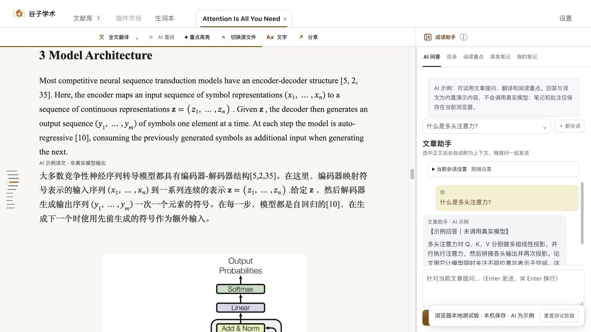
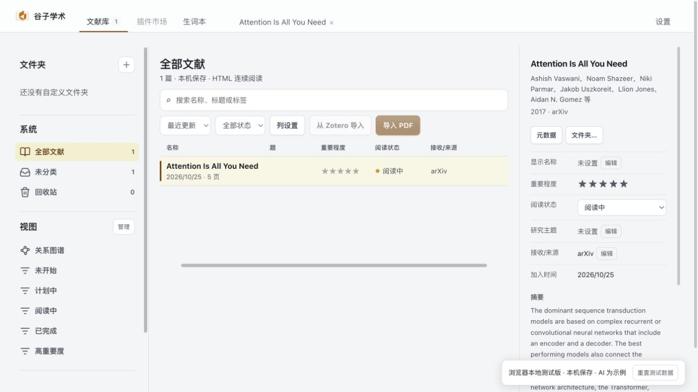
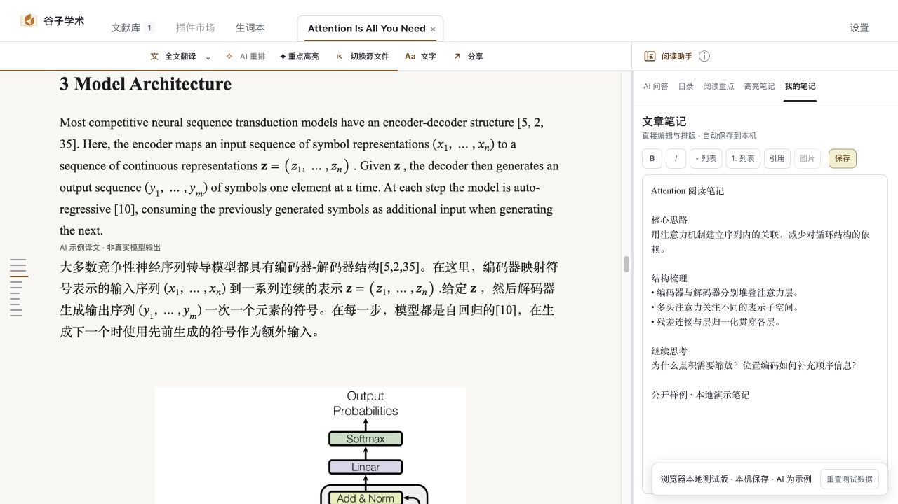
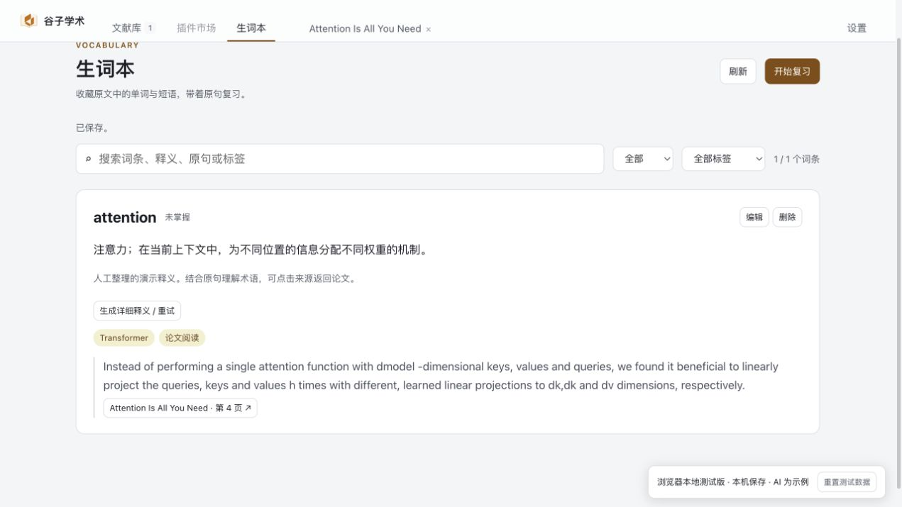

<p align="center">
  
</p>

<h1 align="center">Guzi Scholar</h1>

<p align="center">
  <b>Read English papers, understand them, and keep what you learn.</b><br />
  A local-first academic PDF reader that puts your library, continuous reading with translation, annotations, notes, and vocabulary review in one desktop app
</p>

<p align="center">
  <a href="https://s.guzilab.com">Website</a> ·
  <a href="https://scholar.guzilab.com">Browser demo</a> ·
  <a href="https://github.com/holamochi/Guzi-Scholar/releases/latest">Download</a> ·
  <a href="https://github.com/holamochi/Guzi-Scholar/issues">Issues</a> ·
  <a href="README.md">中文</a>
</p>



<sub>All screenshots come from the browser demo with the public paper “Attention Is All You Need”. AI translations and answers are preset examples, not live model output.</sub>

## Why Guzi Scholar

Reading a paper in a second language usually means juggling five tools: a PDF viewer, a translation site, a note app, a vocabulary list, and a reference manager. When you finish the paper, what you learned is spread across all five.

Guzi Scholar keeps that whole loop in one app, and keeps your papers and notes on your own computer by default.

## Highlights

- **Continuous reading**: PDFs become a reflowable page with adjustable font size and line spacing, plus a table of contents.
- **Translation on demand**: translate a selection for a hard sentence, or the whole paper for a full read. Translations are cached locally.
- **Reading assistant**: ask questions about the paper you are reading, answered from its context.
- **Annotations and notes**: highlights, comments, and per-paper notes with images. Your own annotations are stored apart from AI-suggested highlights.
- **Vocabulary in context**: saved words keep their original sentence and source paper, so you can jump back to see how they were used.
- **Library management**: folders, reading status, custom properties, filtered views, and Zotero import.
- **Bring your own model**: configure translation and the reading assistant separately with any supported API format, such as OpenAI-compatible. No model or API key is bundled.
- **Connect AI clients**: let Claude Code, Codex, and other MCP clients look up your library.

| Library and reading status | Notes and annotations | Vocabulary with source sentences |
| --- | --- | --- |
|  |  |  |

## Try it in your browser

Open **[scholar.guzilab.com](https://scholar.guzilab.com)** to try the reading sidebar, notes, annotations, and vocabulary with a public sample paper. Nothing to install; your edits stay in the current browser.

The AI answers and translations in the demo are labelled presets and do not call a real model. Uploading PDFs, re-parsing, Zotero import, and live AI services need the desktop app.

## Download

| Platform | Version | Get it |
| --- | --- | --- |
| macOS (Apple Silicon) | Latest, actively maintained | `.dmg` from [Releases](https://github.com/holamochi/Guzi-Scholar/releases/latest) |
| Windows x64 | v0.6.7, updated only at major releases | [v0.6.7 Release](https://github.com/holamochi/Guzi-Scholar/releases/tag/v0.6.7) |

The macOS app bundles Python, Java, Pandoc, and the other runtimes it needs. It checks for updates at launch and verifies them with Sparkle signatures before installing.

Windows builds are paused for day-to-day releases but not discontinued; Windows support will be updated at major versions.

> **Blocked by macOS on first launch?** The app is ad-hoc signed and not yet notarized by Apple. In Finder, right-click “谷子学术.app”, choose **Open**, then confirm.

## Get started

1. Import a PDF and wait for local conversion to finish.
2. In Settings, configure the endpoint, API key, and model for translation and for the reading assistant. Without them, library management, reading, annotations, and local notes still work.
3. Open a paper and read: translate, annotate, take notes, or save words as you go.
4. (Optional) In **Settings → MCP**, choose which capabilities to expose. Sign in with a Guzi account and create a token to connect clients to `https://mcp.guzilab.com/scholar` without a local bridge. Keep Guzi Scholar running while you use it; manage tokens at [account.guzilab.com](https://account.guzilab.com).

For PDFs with complex layouts, you can connect your own GLM-OCR + MinerU fusion parsing service on a Linux NVIDIA GPU server. See [Remote parser setup](docs/remote-parser.md) (in Chinese).

## Data and privacy

PDFs, translations, notes, annotations, vocabulary, settings, and AI configuration stay on your device by default. You can choose where the library lives in Settings.

Local-first does not mean fully offline. These optional features send data out:

- **Online metadata lookup** sends paper identifiers, titles, or author candidates to public metadata services.
- **Translation, reading assistant, and AI explanations** send the relevant text, paper context, or images you attach to the services you configured.
- **Remote parsing** uploads the original PDF to your parsing server; results are downloaded and stored locally.
- **Cloud MCP** relays tool calls and results through `mcp.guzilab.com` to your computer. The relay stores no paper content, only tool names and timings.

## Development

```sh
npm ci
npm --prefix apps/desktop ci
npm run desktop:dev     # start the desktop app in development
npm run desktop:check   # checks
npm run build:mac       # build the macOS package
```

Day-to-day development and acceptance testing happen on macOS. Project layout, release process, and Windows build notes are in [docs/development.md](docs/development.md) (in Chinese).

Issues and pull requests are welcome. For packaging changes, please state the target OS, architecture, install method, and how you verified it. Report security issues privately as described in [SECURITY.md](SECURITY.md). Never commit real API keys, user data, `data/`, `developer.tokens.json`, or local build output.

## Topic / Keywords

- **Problem**: reading papers in a second language means switching between a PDF viewer, a translator, a note app, a vocabulary list, and a reference manager, so what you learn ends up scattered and hard to revisit.
- **Approach**: a desktop app converts PDFs into a reflowable reading view (local parsing, or optional GLM-OCR + MinerU on your own GPU server), then offers selection or full-text translation, paper-grounded Q&A, annotations, notes, and a vocabulary list that keeps each source sentence, all in one window. Data stays local; AI features use the user's own OpenAI-compatible API.
- **Category**: academic PDF reader · paper translation tool · reference manager · academic English reading aid · macOS / Windows desktop app · MCP server
- **Not to be confused with**: a paper search engine, or a writing or submission tool. It bundles no LLM and supplies no API keys; the browser demo cannot upload PDFs.
- **Keywords**: academic PDF reader, research paper reader, paper translation, full-text translation, PDF annotation, literature notes, reference manager, vocabulary builder, reflowable PDF, GLM-OCR, MinerU, Zotero import, local-first, AI reading assistant, OpenAI-compatible API, MCP server, Electron
- **中文关键词**：论文阅读器、PDF 翻译、文献管理、论文笔记、PDF 标注、生词本、学术英语、本地优先

## TL;DR

> Guzi Scholar is a local-first paper reader: read, translate, ask, annotate, take notes, and learn vocabulary in one window, with your data kept on your computer.

## Link

- GitHub: https://github.com/holamochi/Guzi-Scholar
- Website: https://s.guzilab.com
- Browser demo: https://scholar.guzilab.com
- Similar projects:
  - Zotero (reference manager and PDF reader): https://github.com/zotero/zotero
  - PDFMathTranslate (layout-preserving paper PDF translation): https://github.com/PDFMathTranslate/PDFMathTranslate
  - Zotero PDF Translate (PDF translation plugin for Zotero): https://github.com/windingwind/zotero-pdf-translate

## License

Original code in this project is licensed under the [Apache License 2.0](LICENSE). If you modify or redistribute it, keep the attribution in [NOTICE.md](NOTICE.md) and follow the licenses of third-party dependencies, fonts, icons, and paper content.
