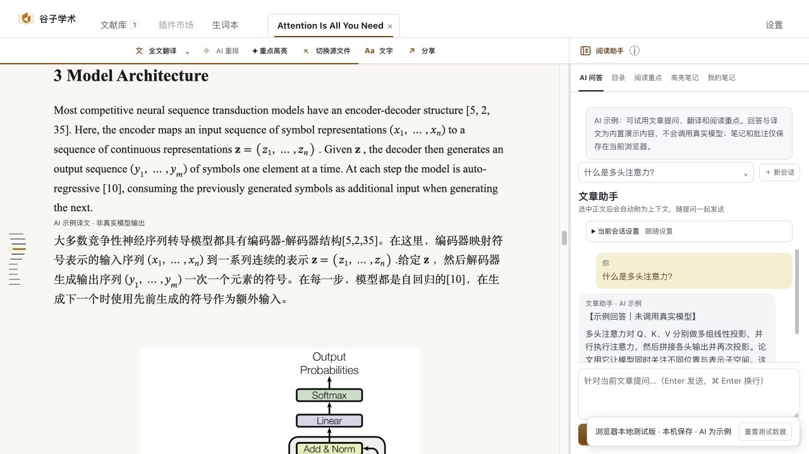
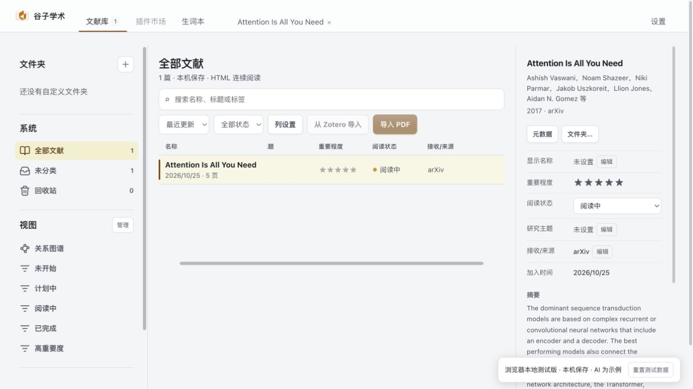
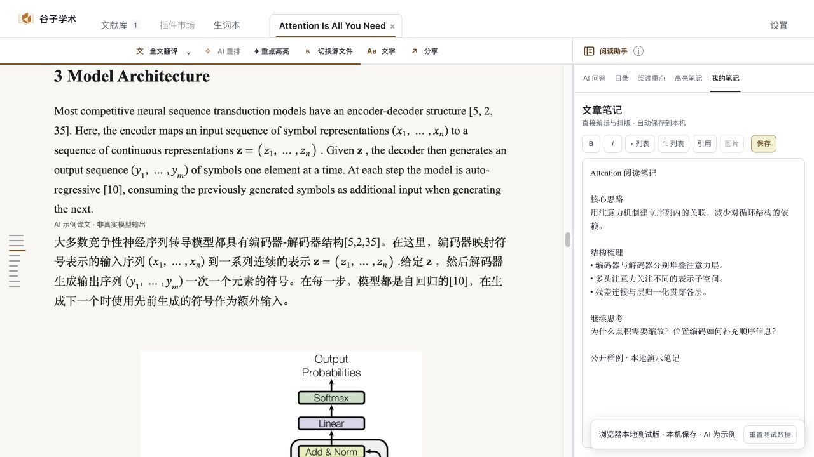
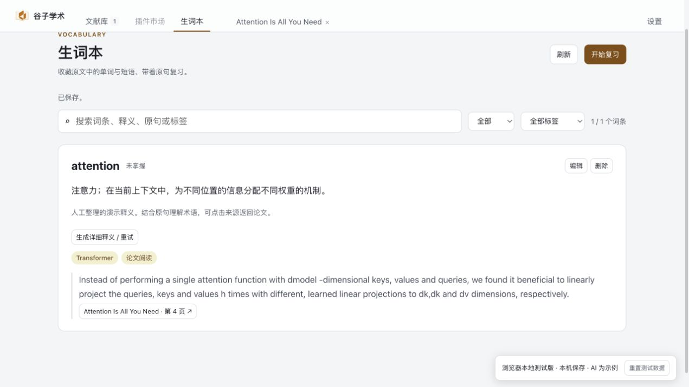

<p align="center">
  
</p>

<h1 align="center">谷子学术 Guzi Scholar</h1>

<p align="center">
  <b>把英文论文读懂、记住、留下自己的笔记。</b><br />
  本地优先的学术 PDF 阅读器：文献整理、连续阅读与翻译、标注笔记、生词复习，放在同一个桌面应用里
</p>

<p align="center">
  <a href="https://s.guzilab.com">官网</a> ·
  <a href="https://scholar.guzilab.com">在线体验</a> ·
  <a href="https://github.com/holamochi/Guzi-Scholar/releases/latest">下载</a> ·
  <a href="https://github.com/holamochi/Guzi-Scholar/issues">反馈问题</a> ·
  <a href="README.en.md">English</a>
</p>



<sub>本页截图均来自网页演示，使用公开论文《Attention Is All You Need》作为样例；AI 译文和回答为预置示例，不代表实时模型效果。</sub>

## 为什么做谷子学术

读英文论文时，常见的流程是：PDF 阅读器里看原文，翻译网站里贴段落，笔记软件里写想法，单词本里记生词，文献管理软件里整理条目。五个工具来回切换，读完一篇论文，积累却散落在五个地方。

谷子学术把这条链路收拢到一个应用里，论文和阅读成果默认都保存在你的电脑上。

## 亮点

- **连续阅读**：把 PDF 转成可调字号和行距的连续页面，配合目录跳转，不用在固定版面里放大缩小。
- **按需翻译**：难句用选区翻译，需要通读时用全文翻译；译文缓存在本机，再次打开不用重新翻译。
- **阅读助手**：围绕当前论文提问，回答基于论文上下文。
- **标注与笔记**：高亮、批注、带图片的文章笔记。你自己的标注和 AI 标出的阅读重点分开保存，回看时一眼能分清。
- **生词本**：收藏单词时同时保存原句和出处，复习时可以回到论文里看它的用法。
- **文献管理**：文件夹、阅读状态、自定义属性和筛选视图，支持 Zotero 导入。
- **用你自己的模型**：翻译和阅读助手分别配置 API（OpenAI 兼容等格式），应用本身不内置模型，也不提供密钥。
- **接入 AI 客户端**：通过 MCP 让 Claude Code、Codex 等客户端查阅你的文献库。

| 文献库与阅读状态 | 文章笔记与标注 | 生词本与原句出处 |
| --- | --- | --- |
|  |  |  |

## 先在浏览器里试试

打开 **[scholar.guzilab.com](https://scholar.guzilab.com)**，不用安装，就能用公开论文样例体验阅读侧边栏、笔记、批注和生词本。编辑内容保存在当前浏览器里。

网页版的 AI 回答和译文都是标注过的预置示例，不调用真实模型。上传 PDF、重新解析、Zotero 导入和真实 AI 服务需要使用桌面版。

## 下载安装

| 平台 | 版本 | 获取方式 |
| --- | --- | --- |
| macOS（Apple Silicon） | 最新版，持续更新 | [Releases](https://github.com/holamochi/Guzi-Scholar/releases/latest) 中的 `.dmg` |
| Windows x64 | v0.6.7，只在大版本集中更新 | [v0.6.7 Release](https://github.com/holamochi/Guzi-Scholar/releases/tag/v0.6.7) |

如果 GitHub 下载较慢，可以到[官网](https://s.guzilab.com)使用国内下载线路。macOS 版已内置 Python、Java、Pandoc 等运行时，安装后即可使用；启动时会自动检查更新，更新包经 Sparkle 签名校验后安装。

Windows 版暂缓日常迭代，但不会停止开发，后续会按大版本集中适配和发布。

> **首次打开被 macOS 拦截？** 安装包使用 ad-hoc 签名，尚未经过 Apple 公证。请在访达中右键点击「谷子学术.app」，选择「打开」，再确认一次即可。

## 快速上手

1. 导入 PDF，等待本地转换完成。
2. 在设置中分别配置翻译和阅读助手的服务地址、API Key 和模型。不配置也能使用文献管理、阅读、标注和本地笔记。
3. 打开论文开始阅读，按需翻译、标注、记笔记或收藏生词。
4. （可选）在「设置 → MCP 连接」中授权需要开放的能力。登录谷子账号并新建 token 后，客户端可以连接固定地址 `https://mcp.guzilab.com/scholar`，不用配置本机桥接。使用时请保持谷子学术运行；token 可以在 [account.guzilab.com](https://account.guzilab.com) 管理。

遇到复杂版面的 PDF，可以接入自己部署的 GLM-OCR + MinerU 融合解析服务，需要一台 Linux NVIDIA GPU 服务器，配置方法见 [远端解析服务器配置](docs/remote-parser.md)。

## 数据与隐私

PDF、译文、笔记、标注、生词、设置和 AI 配置默认都保存在当前设备，文献库位置可以在设置中更改。

「本地优先」不等于完全离线，以下功能会把数据发到外部：

- **在线元数据检索**：把论文标识符、标题或作者候选发送到对应的公共服务。
- **翻译、阅读助手、AI 释义**：把相关文本、文章上下文或你主动加入的图片发送到你配置的服务。
- **远端融合解析**：把原 PDF 上传到你指定的解析服务器，结果下载后保存在本机。
- **云端 MCP**：工具调用和结果经谷子云端（`mcp.guzilab.com`）转发到你的电脑。云端不保存文献内容，只记录工具名和耗时。

## 参与开发

```sh
npm ci
npm --prefix apps/desktop ci
npm run desktop:dev     # 启动桌面开发环境
npm run desktop:check   # 检查
npm run build:mac       # 构建 macOS 安装包
```

日常开发和验收都在 macOS 上进行。目录结构、发布流程和 Windows 构建说明见 [docs/development.md](docs/development.md)。

欢迎通过 Issue 和 Pull Request 反馈问题、提交改进；涉及平台打包的改动，请注明目标系统、架构、安装方式和验证结果。安全问题请按 [SECURITY.md](SECURITY.md) 私下报告。请不要把真实 API Key、用户数据、`data/`、`developer.tokens.json` 或本地构建产物提交到 Git。

## Topic / Keywords

- **解决的问题**：读英文论文要在 PDF 阅读器、翻译工具、笔记软件、单词本和文献管理软件之间来回切换，阅读积累分散，也难以回溯。
- **实现方式**：桌面端把 PDF 转成可重排的连续阅读页面（本地解析，可选 GLM-OCR + MinerU 远端 GPU 解析），在同一界面里提供选区或全文翻译、基于论文上下文的问答、标注、笔记和带原句的生词本；数据默认保存在本机，AI 能力使用用户自己配置的 OpenAI 兼容 API。
- **产品类别**：学术 PDF 阅读器 · 论文翻译工具 · 文献管理 · 英语学术阅读辅助 · macOS / Windows 桌面应用 · MCP Server
- **容易混淆**：它不是论文搜索引擎，也不是投稿或写作工具；不内置大模型，也不提供 API 密钥；网页版只是演示，不支持上传 PDF。
- **中文关键词**：论文阅读器、PDF 翻译、全文翻译、选区翻译、文献管理、论文笔记、PDF 标注、生词本、学术英语、Zotero 导入、本地优先、AI 阅读助手
- **English keywords**: academic PDF reader, paper translation, research paper reader, PDF annotation, reference manager, literature notes, vocabulary builder, reflowable PDF, GLM-OCR, MinerU, Zotero import, local-first, OpenAI-compatible API, MCP server, Electron desktop app

## TL;DR

> 谷子学术：一个本地优先的论文阅读器，在一个窗口里完成读、译、问、标注、记笔记和背生词，数据都留在你的电脑上。

## Link

- GitHub 仓库：https://github.com/holamochi/Guzi-Scholar
- 官网：https://s.guzilab.com
- 在线体验：https://scholar.guzilab.com
- 同类项目：
  - Zotero（文献管理与 PDF 阅读）：https://github.com/zotero/zotero
  - PDFMathTranslate（保留排版的论文 PDF 翻译）：https://github.com/PDFMathTranslate/PDFMathTranslate
  - Zotero PDF Translate（Zotero 内的 PDF 翻译插件）：https://github.com/windingwind/zotero-pdf-translate

## 开源许可

本项目自有代码以 [Apache License 2.0](LICENSE) 开源。二次开发和再发布时，请保留 [NOTICE.md](NOTICE.md) 中的来源说明，并遵守第三方依赖、字体、图标和论文内容各自的授权条款。
