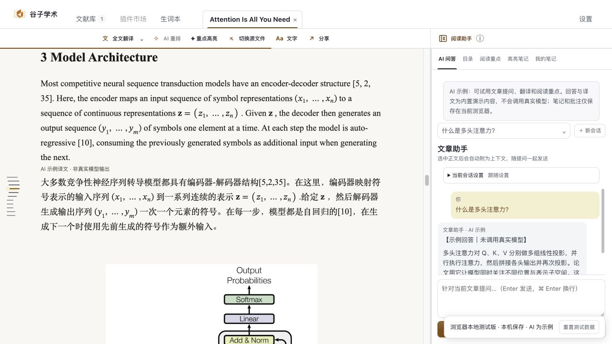
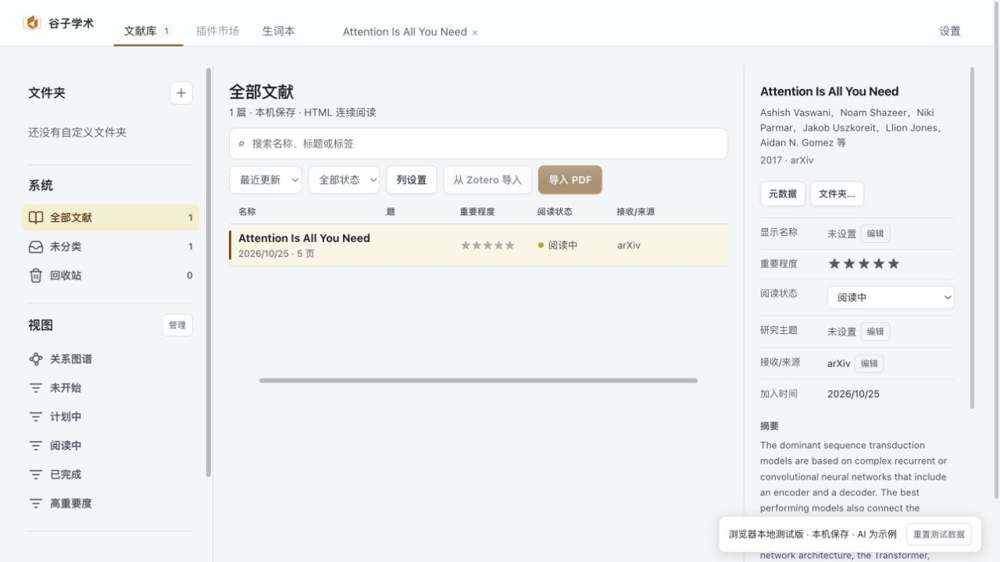
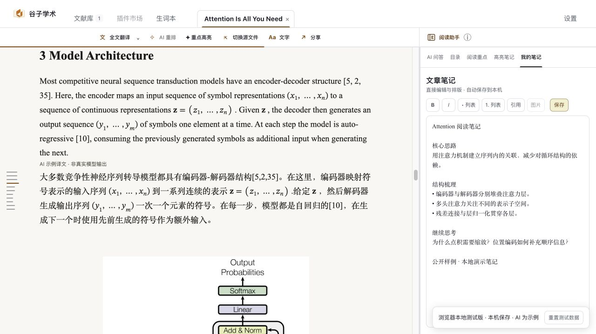
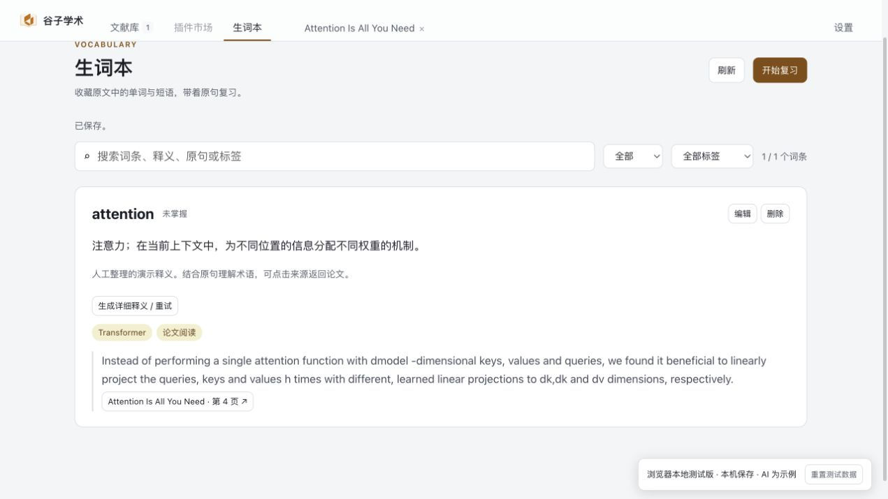

# 谷子学术（Guzi Scholar）

本地优先的学术 PDF 阅读器，把文献整理、连续阅读与翻译、标注笔记和生词复习放在同一个桌面应用中。

论文和阅读成果默认保存在本机；翻译与文章助手由你配置自己的 API 服务。

[下载桌面版](https://github.com/Drangon-Li/Guzi-Scholar/releases) · [在线体验](https://scholar.guzilab.com/) · [English](README.en.md)



*截图来自公开《Attention Is All You Need》样例的网页演示；AI 译文和回答均为预置示例，不代表实时模型效果，也不展示私人文献库。*

## 从整理到读懂，再留下自己的积累

### 1. 整理文献，找到下一篇要读的论文

导入 PDF，用文件夹、阅读状态、自定义属性和筛选视图整理文献。按自己的研究主题安排阅读，把待读、在读和已读的论文放在清楚的位置。



*截图来自公开《Attention Is All You Need》样例的网页演示；AI 译文和回答均为预置示例，不代表实时模型效果，也不展示私人文献库。*

### 2. 连续阅读，在上下文中理解原文

将 PDF 转为连续阅读页面，结合目录和可调整的字号、行距阅读正文。遇到难句时使用选区翻译，需要通读时使用全文翻译；也可以围绕文章向阅读助手提问。译文缓存保存在本机，方便再次阅读。

本地转换可直接使用安装包附带的工具；复杂版面也可选择自行部署的 GLM-OCR + MinerU 融合解析服务。转换质量取决于原始 PDF 和所用解析引擎。翻译、问答等 AI 功能需要自行配置服务。

### 3. 标注与笔记，保留自己的理解

在阅读时高亮原文、添加批注，并用文章笔记整理问题与结论。笔记支持插入图片；个人标注与 AI 阅读重点分开保存，回看时能区分自己的记录和模型建议。



*截图来自公开《Attention Is All You Need》样例的网页演示；AI 译文和回答均为预置示例，不代表实时模型效果，也不展示私人文献库。*

### 4. 收藏生词，带着原句复习

选中原文中的单词或短语，加入生词本并保留原句与文献来源。可以编辑释义、标签和备注，按“未掌握 / 已掌握”筛选复习，再回到论文上下文查看用法。



*截图来自公开《Attention Is All You Need》样例的网页演示；AI 译文和回答均为预置示例，不代表实时模型效果，也不展示私人文献库。*

## 先试用，再安装

**[打开网页体验版 → scholar.guzilab.com](https://scholar.guzilab.com/)**

无需安装即可用公开论文样例体验阅读侧边栏、笔记、批注和生词本。编辑内容保存在当前浏览器，刷新后保留，也可重置测试数据。

网页中的 AI 回答和译文均为明确标注的预置示例，不调用真实模型。加载网页及样例需要联网；PDF 上传、重新解析、Zotero 导入和真实 AI 服务请使用桌面版。

## 下载与平台支持

前往 [Releases](https://github.com/Drangon-Li/Guzi-Scholar/releases) 下载桌面安装包：

| 平台 | 产物 | 当前状态 |
| --- | --- | --- |
| macOS Apple Silicon | `.dmg`（安装）、`.zip`（应用内更新） | 持续维护，尚未公证 |
| Windows x64 | `.exe` / `.zip` | 按大版本计划在关键版本更新；现有安装包可从历史 Releases 下载 |

macOS 是当前主要开发与发布平台，日常功能迭代、本机测试和默认 CI 验证均以 macOS 为目标。

**Windows 版本暂缓日常持续迭代，但不会终止开发。** 后续将按照项目大版本的目标和需求，集中推进 Windows 适配、测试与发布，仅在关键版本更新，不跟随每次 macOS 小版本同步发行。Windows 源码和手动构建入口继续保留。

macOS 发布包内置 Python、Java、Pandoc、OpenDataLoader 和 PyMuPDF 运行时，使用 ad-hoc 签名，尚未通过 Apple Developer ID 签名或 Apple 公证。首次打开时如果遇到 Gatekeeper 提示，请在 Finder 中右键“谷子学术.app”并选择“打开”，再确认提示。应用支持启动时检查更新及手动检查，通过 Sparkle 校验更新签名后安装；也可从 Releases 下载 DMG 手动更新。

## 开始使用

1. 安装桌面版，导入自己的 PDF，等待本地转换完成。
2. 在设置中配置翻译与文章助手的服务地址、API Key 和模型。两项服务可以分别配置，支持 OpenAI-compatible API 等界面提供的服务格式；应用不提供供应商密钥或内置大模型。
3. 打开论文开始阅读，按需翻译、标注、记笔记或收藏生词。未配置 AI 服务时，文献管理、已转换内容的阅读、标注和本地笔记仍可使用。

需要使用自建 GPU 解析服务时，见下方[远端解析服务器配置](#远端解析服务器配置)。

## 数据与隐私

PDF、译文、笔记、标注、生词、设置和 AI 配置默认保存在当前设备。安装版将应用状态和文献库分别保存，也可以在设置中选择文献库位置。

“本地优先”不代表所有功能都离线运行：

- 开启在线元数据检索时，论文标识符、标题或作者候选会发送到相应公共服务。
- 使用翻译、文章助手或 AI 辅助释义时，相应文本、文章上下文或你明确加入的图片会发送到自行配置的服务。
- 启用远端融合解析时，原 PDF 会上传到你指定的解析服务器，解析结果下载后保存在本机。

不要把真实 API Key、用户数据、`data/`、`developer.tokens.json` 或本地构建产物提交到 Git。

## 远端解析服务器配置

远端融合解析是可选功能，需要你自己的 Linux NVIDIA GPU 服务器。安装包不附带公共解析服务器、访问凭据或模型权重。启用后，导入 PDF 和 AI 重新排版会把原 PDF 上传到指定服务器；结果下载后仍保存在本机。翻译和文章助手的 API 配置与解析服务器配置相互独立。

<details>
<summary>展开连接配置、自行部署步骤与常见问题</summary>

### 已有解析服务器：连接桌面端

向服务器管理员获取以下信息。这里的 `18770` 是**解析服务端口**，SSH 端口通常是 `22`，两者不要混用。

| 配置项 | 示例 | 说明 |
| --- | --- | --- |
| SSH 主机、端口、用户 | `parser.example.com`、`22`、`guzi` | 用于建立加密转发 |
| SSH 私钥路径 | `~/.ssh/guzi-parser` | 填本机文件路径，不填私钥内容 |
| 已验证的主机指纹文件 | `~/.ssh/known_hosts` | 先经可信渠道核对服务器指纹，再用 SSH 正常连接一次 |
| 远端解析端口 | `18770` | 服务只监听服务器的 `127.0.0.1` |
| 本机转发端口 | `18770` | 必须空闲，可改为其他空闲端口 |
| 解析 token | 管理员提供的私有 token | 与服务器 token 文件中的值相同；不是翻译 API key |

在桌面端状态目录创建 `remote-parser.config.json`。源码启动默认为 `apps/desktop/data/`；macOS 安装版为 Electron 用户数据目录下的 `state/`，通常位于 `~/Library/Application Support/谷子学术/state/` 或 `~/Library/Application Support/my-scholar/state/`（以实际已有的 `settings.json`、`renderer-state/` 所在目录为准）。自定义 `MY_SCHOLAR_DATA_DIR` 时使用该目录。不要将配置写入 `.app` 安装包。

```json
{
  "remote_parser": {
    "enabled": true,
    "base_url": "http://127.0.0.1:18770",
    "token": "REPLACE_WITH_PRIVATE_PARSER_TOKEN",
    "ssh": {
      "enabled": true,
      "host": "parser.example.com",
      "port": 22,
      "user": "guzi",
      "identity_file": "~/.ssh/guzi-parser",
      "known_hosts_file": "~/.ssh/known_hosts",
      "local_port": 18770,
      "remote_port": 18770
    }
  }
}
```

保存后将文件权限设为 `600`，重启应用，在 **设置 → 版面引擎 → 远端融合解析服务 → 连接并检测** 确认已连接，再导入 PDF 或点击 AI 重新排版。若更改本机端口，应同时更改 `base_url` 和 `local_port`。应用会管理自己创建的 SSH 隧道，不会接管已有端口上的进程。

配置路径优先级是：环境变量 `MY_SCHOLAR_REMOTE_PARSER_CONFIG` → 状态目录中的 `remote-parser.config.json` → 兼容旧源码配置 `apps/desktop/config.local.json`。需要指定其他位置时，可从终端启动源码版：

```sh
MY_SCHOLAR_REMOTE_PARSER_CONFIG="$HOME/.config/guzi-scholar/remote-parser.config.json" npm run desktop:dev
```

已有自行管理的安全隧道时，将 `ssh.enabled` 设为 `false`，并把 `base_url` 指向该本机端口。由管理员部署 HTTPS 网关时，也可使用 HTTPS 地址；不会接受公网明文 HTTP。私有配置和 token 不应提交 Git。

### 自行部署解析服务

这部分适用于已经安装 GLM-OCR、MinerU 和本地模型的服务器，**仅安装桌面 DMG 或 CPU 依赖不会自动下载 GPU 模型**。

1. 将仓库放在容量足够的数据盘，例如 `/srv/guzi-scholar`，或你自己的数据盘目录。运行前检查 `nvidia-smi`、`free -h` 和 `df -h`。当前服务按单 GPU 顺序运行两种引擎，每次 GPU 阶段要求空闲显存至少 **16 GiB**、可用内存至少 **32 GiB**、可用磁盘至少 **5 GiB**，并拒绝与现有 GPU 计算进程抢占；模型下载和完整环境需要额外空间。
2. 在该目录下创建独立 conda 环境，例如 `conda create -p /srv/guzi-scholar/conda/envs/guzi-scholar python=3.11`。已验证的 GPU 版本见 [`requirements-gpu.txt`](services/parser_service/requirements-gpu.txt)，CPU 依赖见 [`requirements-cpu.txt`](services/parser_service/requirements-cpu.txt)。先确认 CUDA 驱动与对应 PyTorch/vLLM 兼容，再安装。国内网络可优先使用清华 PyPI 镜像和 ModelScope；不要把模型或缓存放入系统根分区。
3. 准备完整本地模型及配置：`models/glm-models.json` 应含 `ocr.snapshot_path` 和 `layout.snapshot_path`，分别指向 GLM-OCR 与布局模型的绝对目录；`mineru4/config.yaml` 使用所装 MinerU 版本的本地模型配置，模型放在 `models/mineru4/`。GLM 布局模型也必须下载；服务运行时启用离线模式，不会临时联网补齐权重。推理包装脚本已包含在仓库 `scripts/glm/`、`scripts/mineru/` 与 `scripts/run_glm_job.py` 中。
4. 复制 [`config.example.json`](services/parser_service/config.example.json) 为服务器上的私有配置，替换 `base`、`python`、`cpu_dependencies` 与 `token_file`。路径都应落在选定的数据盘；`cpu_dependencies` 是安装 CPU 依赖的目录，例如 `python -m pip install -r services/parser_service/requirements-cpu.txt --target /srv/guzi-scholar/envs/fusion-auto-cpu`。创建私有 token 文件，至少 32 个无空白 ASCII 字符，权限必须为 `600`，且位于 `base` 之内。
5. 在仓库根目录使用配置的 Python 启动服务：

   ```sh
   /srv/guzi-scholar/conda/envs/guzi-scholar/bin/python -m services.parser_service.app --config /srv/guzi-scholar/config.local.json
   ```

   在服务器执行 `curl http://127.0.0.1:18770/health`，确认 `ready` 为 `true`。这表示服务和必要文件已就绪；首次真实解析还会检查模型加载和 GPU 资源。长期运行可交由管理员的 systemd 或容器进程管理，保留服务日志与数据目录。
6. 按上一节配置桌面端。用一篇短 PDF 验证上传、排队、解析、下载和阅读，再批量导入。

常见问题：`未配置` 检查配置文件位置和 `enabled`；`SSH 隧道启动失败` 检查 SSH 端口、用户名、私钥及可信主机指纹；`本机转发端口已被占用` 换空闲端口；`HTTP 401` 检查两端 token；`服务尚未就绪` 检查 `/health` 的缺失文件和服务日志；`Resource preflight failed` 释放资源后再试。启用远端后，连接失败会明确报错，不会悄悄切到本地 AI 引擎。


</details>

## 本地开发

```sh
npm ci
npm --prefix apps/desktop ci
npm run desktop:dev
```

常用命令：

```sh
npm run desktop:check:syntax
npm run desktop:check
npm run build:mac
```

完整的桌面服务、前端和测试代码位于 `apps/desktop/`。默认开发与运行时、界面验收在 macOS 上进行；共享代码的静态检查可使用 Linux CI。Windows 启动器及 `build:windows` / `verify:windows` 命令保留，供关键版本的集中适配、构建和验收使用，不属于日常默认验收范围。

macOS Release workflow 会自动准备 Temurin JDK 21、Python 3.11、`certifi`、PyInstaller，并下载固定版本的 OpenDataLoader CLI；当前 GitHub 发布使用 ad-hoc 签名，不需要 GitHub Secrets 中的 Apple Developer ID 或公证凭据。它是可追溯的 GitHub 发布版，但仍需在 Finder 中确认首次启动；未来购买 Apple Developer Program 后，可再启用 Apple 正式签名和公证路径。

默认 Release 只构建 macOS 产物，并要求对应版本的签名、资产完整性检查及真实 macOS 升级验收通过后才能发布。Windows CI 只接受手动触发；纳入大版本计划的 Windows 候选版本，仍须完成 Windows 构建和升级验收后才能发布。

## 项目结构

```text
apps/desktop/
├── electron/       # Electron 主进程、预加载、启动器和桌面 IPC
├── web/            # 阅读器、文献库、设置页和前端资源
├── *.py            # 本地 HTTP 服务、文献库、转换和 AI 适配器
├── scripts/        # 桌面构建、运行时准备和校验脚本
└── tests/          # Python、JavaScript 和桌面流程测试

platforms/
├── windows/        # Windows 安装器、便携包、启动和验收配置
└── macos/          # macOS 发布配置预留目录

android/ ios/       # 当前保留的移动展示壳，暂不参与桌面发行
webseit/             # 只读展示站资源和部署脚本
deploy/              # 私有部署与运维脚本
```

平台层只负责图标、安装器、Python 探测、进程终止、签名和发布配置；业务逻辑、渲染器和本地服务由 `apps/desktop` 共享。

## 许可与贡献

本项目自有代码按 [Apache License 2.0](LICENSE) 授权。二次开发和再发布请保留 [NOTICE.md](NOTICE.md) 中的来源说明，同时遵守第三方依赖、字体、图标和论文内容各自的授权条款。

欢迎通过 Issue 和 Pull Request 反馈问题、提交适配和改进。涉及平台打包的改动请说明目标系统、架构、安装方式和验证结果。
